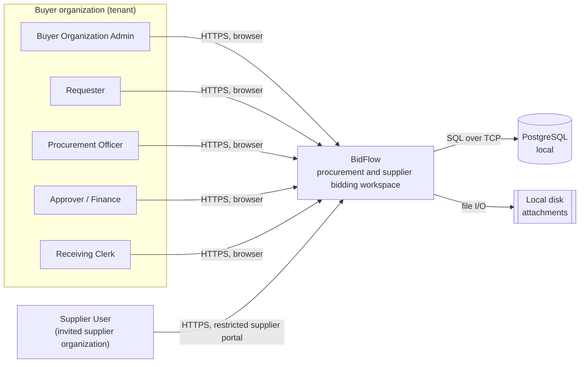
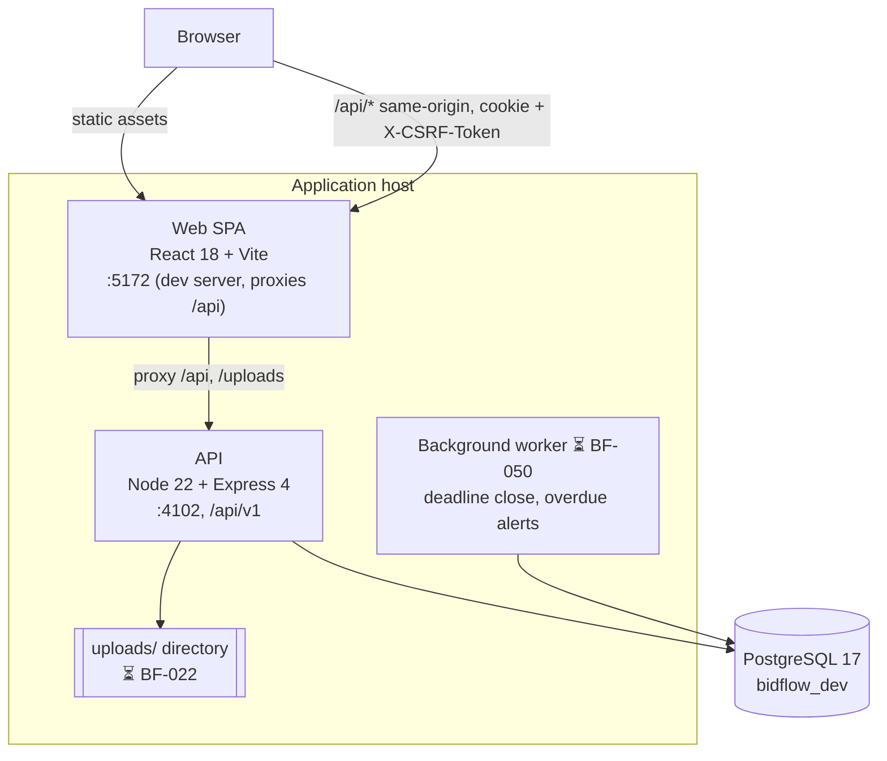
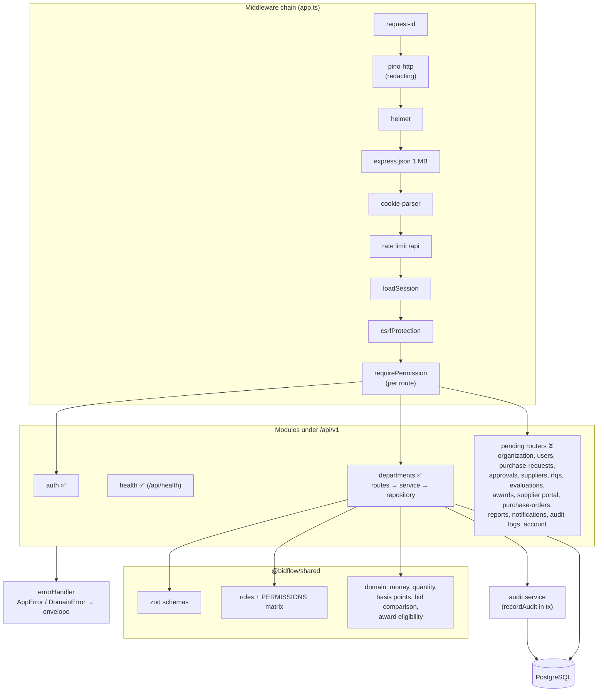

# Architecture overview

BidFlow is a modular monolith (ADR-0002): one Express API, one React single-page application and
one shared TypeScript package, deployed against a single PostgreSQL database. Everything runs
locally with no outbound network dependency (PRD §2).

**Status legend:** ✅ implemented in this repository · ⏳ planned (ticket in
[`../planning/backlog.md`](../planning/backlog.md)).

| Area                                                                                         | Status                    |
| -------------------------------------------------------------------------------------------- | ------------------------- |
| Middleware chain (request id, logging, headers, rate limit, session, CSRF, permission guard) | ✅ BF-002, BF-004         |
| Health endpoints, migrations, audit table                                                    | ✅ BF-003                 |
| Departments with budgets (list / create / get)                                               | ✅ BF-009, BF-010, BF-011 |
| Money + bid comparison domain engine (`@bidflow/shared`)                                     | ✅ BF-007, BF-008         |
| All other PRD §7 endpoints (registered, return 501 + ticket)                                 | ⏳ BF-012 … BF-052        |
| Background worker for deadlines and overdue alerts                                           | ⏳ BF-050                 |

## C4 level 1: system context



Deliberately absent (PRD §1 non-goals): outbound email, ERP/accounting sync, payment rails,
e-signature, FX feeds, supplier discovery marketplaces. Supplier "invitations" are portal records
created in-app (FR-03), and all alerts are in-app notifications (FR-09).

## C4 level 2: containers



| Container      | Technology                   | Responsibility                                                                 | Status                                                            |
| -------------- | ---------------------------- | ------------------------------------------------------------------------------ | ----------------------------------------------------------------- |
| Web SPA        | React, React Router, Vite    | Role-filtered navigation, screens, client-side validation using shared schemas | ✅ shell, login, dashboard landing, departments; ⏳ other screens |
| API            | Express, pg, zod, pino       | Authentication, authorization, validation, business rules, transactions, audit | ✅ foundation + departments; ⏳ remaining modules                 |
| Shared package | TypeScript, zod              | Envelope types, schemas, roles/permissions, pure money and comparison engine   | ✅                                                                |
| PostgreSQL     | PostgreSQL 17                | System of record, tenant-scoped tables, append-only audit                      | ✅ 0001, 0002; ⏳ further migrations                              |
| Worker         | Node process (same codebase) | Scheduled jobs: RFQ deadline transitions, delivery overdue alerts              | ⏳ BF-050                                                         |
| Uploads        | Local filesystem             | Attachment bytes; metadata in SQL                                              | ⏳ BF-022                                                         |

In production the SPA is served as static files behind a reverse proxy that also routes `/api`
to the API (see [`../operations/deployment.md`](../operations/deployment.md)).

## C4 level 3: API components



Pending endpoints are real routes built with `pendingRouter`: they enforce authentication and the
final permission first (401/403), then answer `501 NOT_IMPLEMENTED` with the ticket id. The API
surface therefore already matches [`../api/openapi.yaml`](../api/openapi.yaml).

## Module boundaries

Each module under `apps/api/src/modules/<module>/` owns its routes, service and repository:

| Layer      | Owns                                                                                                                          | Must not                      |
| ---------- | ----------------------------------------------------------------------------------------------------------------------------- | ----------------------------- |
| Routes     | HTTP shape, `parseOrThrow` with shared zod schemas, permission guard, response envelope                                       | Contain SQL or business rules |
| Service    | Business rules, defence-in-depth permission re-check, transactions, audit events, error mapping (e.g. unique violation → 409) | Read `req`/`res`              |
| Repository | Parameterized SQL, every statement scoped by `organization_id`, row → DTO mapping (`parseMinorUnits` for bigint)              | Make authorization decisions  |

`@bidflow/shared` is consumed by both the API and the web:

- `schemas/*` — request/response validation (the same rules run in the browser and at the API boundary).
- `roles.ts` — the six PRD §3 roles and the permission matrix (ADR-0007). The web uses it only to hide navigation.
- `domain/*` — pure functions without I/O: integer money and rounding (ADR-0013), the bid comparison
  and scoring engine (ADR-0014) and award eligibility. They have 100 % branch coverage and are
  reused by the comparison endpoint (⏳ BF-037) and the comparison matrix screen (⏳ BF-039).

Modules talk to each other through services, never through each other's tables. Cross-module
workflows (award approval creating a PO draft) run in a single database transaction owned by the
initiating service (see [`../design/system-design.md`](../design/system-design.md)).

## Request lifecycle

Creating a department (implemented, BF-009):

```mermaid
sequenceDiagram
  autonumber
  participant B as Browser (Buyer Admin)
  participant W as Vite proxy :5172
  participant A as Express API :4102
  participant S as DepartmentService
  participant R as DepartmentRepository
  participant D as PostgreSQL

  B->>W: POST /api/v1/departments (cookie sid, X-CSRF-Token, JSON)
  W->>A: forward
  A->>A: request-id, helmet, rate limit
  A->>D: SELECT session + user (token hash, unexpired, active)
  A->>A: CSRF: Origin = APP_ORIGIN and token = HMAC(session)
  A->>A: requirePermission('departments:manage')
  A->>A: parseOrThrow(createDepartmentSchema)
  A->>S: create(actor, input, requestId)
  S->>S: assertCan(actor, 'departments:manage')
  S->>D: BEGIN
  S->>R: organizationCurrency(actor.organizationId)
  R->>D: SELECT default_currency FROM organizations WHERE id = $1
  S->>R: insert({...input, organizationId, currency, createdBy})
  R->>D: INSERT INTO departments ... RETURNING
  S->>D: INSERT INTO audit_events (department.created)
  S->>D: COMMIT
  S-->>A: Department DTO
  A-->>B: 201 {success: true, data, error: null}
  Note over S,D: Any error → ROLLBACK; 23505 → 409 CONFLICT; no audit row survives
```

## Cross-cutting concerns

| Concern        | Mechanism                                                                                                 | Status                                      | Reference                    |
| -------------- | --------------------------------------------------------------------------------------------------------- | ------------------------------------------- | ---------------------------- |
| Tenancy        | `organization_id` on every tenant table, always taken from the session; foreign records return 404        | ✅ departments; ⏳ every new module         | ADR-0003                     |
| Authentication | Opaque session token (SHA-256 stored), scrypt passwords, HttpOnly SameSite=Lax cookie                     | ✅                                          | ADR-0005                     |
| CSRF           | Origin check + HMAC token header on unsafe methods                                                        | ✅                                          | ADR-0005                     |
| Authorization  | `requirePermission` per route, service re-check, record-level rules in services                           | ✅ matrix; ⏳ record rules (BF-020, BF-033) | ADR-0007, ADR-0015, ADR-0016 |
| Validation     | zod schemas in `packages/shared`, `.strict()` objects reject unknown keys (e.g. client-supplied currency) | ✅                                          | ADR-0006                     |
| Money          | Integer minor units, basis points, ROUND HALF UP once, overflow guards                                    | ✅                                          | ADR-0013                     |
| Audit          | `recordAudit(tx, …)` in the same transaction as the change; append-only table                             | ✅                                          | ADR-0008                     |
| Errors         | `AppError` codes and `DomainError` → consistent envelope; 5xx details never leak                          | ✅                                          | ADR-0006                     |
| Logging        | pino JSON logs with request id; cookies, CSRF header and passwords redacted                               | ✅                                          | ADR-0009                     |
| Configuration  | zod-validated environment at boot; refuses placeholder secret in production                               | ✅                                          | ADR-0009                     |
| Rate limiting  | Global `/api` limiter and stricter login limiter                                                          | ✅                                          | ADR-0005                     |
| Idempotency    | `Idempotency-Key` for approval, award, PO issue, receipt                                                  | ⏳ BF-047                                   | ADR-0017                     |
| Notifications  | In-app inbox; worker for time-based alerts                                                                | ⏳ BF-050                                   | ADR-0012                     |
| Attachments    | Local disk with type/size allow-list                                                                      | ⏳ BF-022                                   | ADR-0011                     |
