# Data model

The complete PRD §6 model, as implemented today and as planned. Status: ✅ table exists
(migration in `apps/api/migrations/`), ⏳ pending (ticket in [`../planning/backlog.md`](../planning/backlog.md)).

## Naming decisions

- `organizations` implements PRD `buyer_organizations` (template foundation table, migration 0001).
- The tenant key column is named **`organization_id`** everywhere (PRD `buyer_org_id`). Every
  tenant-owned table carries it, and every query filters on it with the value from the session
  (ADR-0003).
- `users` + `users.role` implements PRD `users` and `buyer_memberships` for MVP: a user belongs to
  exactly one buyer organization with one role. Department membership is a separate join table
  (⏳ BF-015).
- Supplier logins are `users` rows with role `SUPPLIER_USER`, linked to a supplier organization
  via `supplier_memberships`; PRD `supplier_users` is therefore a view over `users` (ADR-0015).
- `audit_events` implements PRD `audit_logs`.

## Entity-relationship diagram

```mermaid
erDiagram
  organizations ||--o{ users : employs
  organizations ||--o{ sessions : scopes
  users ||--o{ sessions : owns
  organizations ||--o{ audit_events : records
  organizations ||--o{ departments : has
  departments ||--o{ cost_centers : has
  departments ||--o{ budgets : plans
  departments ||--o{ department_memberships : has
  users ||--o{ department_memberships : joins

  organizations ||--o{ supplier_organizations : lists
  supplier_organizations ||--o{ supplier_memberships : has
  users ||--o{ supplier_memberships : "supplier login"
  supplier_organizations ||--o{ supplier_contacts : has

  departments ||--o{ purchase_requests : funds
  users ||--o{ purchase_requests : requests
  purchase_requests ||--|{ purchase_request_lines : contains
  purchase_requests ||--o{ purchase_request_revisions : snapshots
  purchase_requests ||--o{ approval_steps : "subject (request)"
  award_recommendations ||--o{ approval_steps : "subject (award)"

  purchase_requests ||--o{ rfqs : sourced_by
  rfqs ||--|{ rfq_lines : contains
  rfqs ||--o{ rfq_invitations : invites
  supplier_organizations ||--o{ rfq_invitations : receives
  rfqs ||--|{ evaluation_criteria : weighs
  rfqs ||--o{ supplier_bids : receives
  supplier_organizations ||--o{ supplier_bids : submits
  supplier_bids ||--|{ supplier_bid_lines : prices
  rfq_lines ||--o{ supplier_bid_lines : quoted_by
  supplier_bids ||--o{ evaluation_scores : scored
  evaluation_criteria ||--o{ evaluation_scores : on
  supplier_bids ||--o| bid_qualifications : qualified_by
  rfqs ||--o{ award_recommendations : recommends
  supplier_bids ||--o{ award_recommendations : selected

  award_recommendations ||--o| purchase_orders : creates
  supplier_organizations ||--o{ purchase_orders : supplies
  purchase_orders ||--|{ purchase_order_lines : contains
  rfq_lines ||--o{ purchase_order_lines : from
  purchase_orders ||--o{ receipts : receives
  receipts ||--|{ receipt_lines : contains
  purchase_order_lines ||--o{ receipt_lines : against

  organizations ||--o{ attachments : stores
  users ||--o{ notifications : receives
  organizations ||--o{ idempotency_keys : dedupes

  organizations {
    uuid id PK
    text name
    text slug UK
    char3 default_currency
    text timezone "pending BF-012"
    bigint approval_threshold_minor "pending BF-012"
  }
  users {
    uuid id PK
    uuid organization_id FK
    text email UK
    text display_name
    text role "CHECK six roles"
    text password_hash
    boolean is_active
  }
  sessions {
    text token_hash PK
    uuid user_id FK
    uuid organization_id FK
    timestamptz expires_at
  }
  audit_events {
    bigserial id PK
    uuid organization_id FK
    uuid actor_user_id FK
    text action
    text entity_type
    text entity_id
    jsonb metadata
    text request_id
    timestamptz occurred_at
  }
  departments {
    uuid id PK
    uuid organization_id FK
    text code
    text name
    text budget_period
    bigint budget_minor
    char3 currency
    boolean is_active
    int version
  }
  cost_centers {
    uuid id PK
    uuid organization_id FK
    uuid department_id FK
    text code
    text name
  }
  budgets {
    uuid id PK
    uuid organization_id FK
    uuid department_id FK
    date period_start
    bigint amount_minor
    int version
  }
  department_memberships {
    uuid organization_id FK
    uuid department_id FK
    uuid user_id FK
    boolean is_manager
  }
  supplier_organizations {
    uuid id PK
    uuid organization_id FK
    text name
    text contact_name
    text email
    text_array categories
    text tax_registration_text
    char2 country
    text status
    text performance_notes
  }
  supplier_memberships {
    uuid organization_id FK
    uuid supplier_org_id FK
    uuid user_id FK
  }
  supplier_contacts {
    uuid id PK
    uuid organization_id FK
    uuid supplier_org_id FK
    text name
    text email
    text phone
  }
  purchase_requests {
    uuid id PK
    uuid organization_id FK
    uuid department_id FK
    uuid requester_id FK
    text code
    text status
    bigint estimated_total_minor
    char3 currency
    date needed_by
    int version
    timestamptz created_at
  }
  purchase_request_lines {
    uuid id PK
    uuid organization_id FK
    uuid request_id FK
    text description
    text category
    text unit
    numeric qty_decimal
    bigint estimated_unit_minor
  }
  purchase_request_revisions {
    uuid id PK
    uuid organization_id FK
    uuid request_id FK
    int revision
    jsonb snapshot
    text snapshot_sha256
  }
  approval_steps {
    uuid id PK
    uuid organization_id FK
    text subject_type
    uuid subject_id
    int step_order
    text required_role
    text status
    uuid decided_by FK
    timestamptz decided_at
    text reason
  }
  rfqs {
    uuid id PK
    uuid organization_id FK
    uuid request_id FK
    text code
    text status
    char3 currency
    timestamptz deadline_at
    int revision
    timestamptz published_at
    timestamptz closed_at
  }
  rfq_lines {
    uuid id PK
    uuid organization_id FK
    uuid rfq_id FK
    text description
    text unit
    numeric qty_decimal
    jsonb spec_json
    int sort_order
  }
  rfq_invitations {
    uuid id PK
    uuid organization_id FK
    uuid rfq_id FK
    uuid supplier_org_id FK
    text status
  }
  evaluation_criteria {
    uuid id PK
    uuid organization_id FK
    uuid rfq_id FK
    text label
    text category "PRICE or QUALITATIVE"
    int weight_bps
    int sort_order
  }
  supplier_bids {
    uuid id PK
    uuid organization_id FK
    uuid rfq_id FK
    uuid supplier_org_id FK
    int revision
    text status
    timestamptz submitted_at
    text notes
  }
  supplier_bid_lines {
    uuid id PK
    uuid organization_id FK
    uuid bid_id FK
    uuid rfq_line_id FK
    bigint unit_price_minor
    int lead_days
    boolean compliant
    text notes
  }
  evaluation_scores {
    uuid id PK
    uuid organization_id FK
    uuid rfq_id FK
    uuid bid_id FK
    uuid criterion_id FK
    smallint score_0_to_100
    uuid evaluator_id FK
    text rationale
  }
  bid_qualifications {
    uuid id PK
    uuid organization_id FK
    uuid bid_id FK
    boolean qualified
    text decision_reason
    uuid decided_by FK
  }
  award_recommendations {
    uuid id PK
    uuid organization_id FK
    uuid rfq_id FK
    uuid bid_id FK
    uuid evaluator_id FK
    text status
    text justification
    jsonb award_snapshot_json
  }
  purchase_orders {
    uuid id PK
    uuid organization_id FK
    uuid award_id FK "UNIQUE"
    uuid supplier_org_id FK
    text po_code
    text status
    bigint total_minor
    char3 currency
    timestamptz issued_at
    jsonb terms_snapshot_json
    int version
  }
  purchase_order_lines {
    uuid id PK
    uuid organization_id FK
    uuid purchase_order_id FK
    uuid rfq_line_id FK
    numeric quantity
    bigint unit_price_minor
  }
  receipts {
    uuid id PK
    uuid organization_id FK
    uuid purchase_order_id FK
    uuid recorded_by FK
    timestamptz received_at
    text note
  }
  receipt_lines {
    uuid id PK
    uuid organization_id FK
    uuid receipt_id FK
    uuid purchase_order_line_id FK
    numeric qty_received
  }
  attachments {
    uuid id PK
    uuid organization_id FK
    text owner_type
    uuid owner_id
    text original_name
    text storage_key
    bigint size_bytes
    text sha256
  }
  notifications {
    uuid id PK
    uuid organization_id FK
    uuid recipient_user_id FK
    text kind
    uuid subject_id
    timestamptz read_at
  }
  idempotency_keys {
    uuid organization_id FK
    text key
    text request_sha256
    jsonb response
    timestamptz expires_at
  }
```

## Conventions

| Topic              | Convention                                                                                                                                                                                                                                              |
| ------------------ | ------------------------------------------------------------------------------------------------------------------------------------------------------------------------------------------------------------------------------------------------------- |
| Primary keys       | `uuid DEFAULT gen_random_uuid()` (pgcrypto); `audit_events` uses `bigserial` for ordering                                                                                                                                                               |
| Tenant key         | `organization_id uuid NOT NULL REFERENCES organizations(id) ON DELETE RESTRICT`; tables also expose `UNIQUE (organization_id, id)` so children can use composite tenant-safe foreign keys `(organization_id, parent_id)`                                |
| Money              | `bigint` integer minor units (`*_minor`), `CHECK (x BETWEEN 0 AND 9007199254740991)` so values stay inside the JavaScript safe-integer range; currency `char(3)` `CHECK (~ '^[A-Z]{3}$')`. Parsed with `parseMinorUnits`, never `parseFloat` (ADR-0013) |
| Rates and weights  | Integer basis points (`weight_bps`, 10 000 = 100 %)                                                                                                                                                                                                     |
| Quantities         | `numeric(14,3)`; converted to integer milli-units (`quantityMilli`, ×1000) at the repository boundary and multiplied in BigInt                                                                                                                          |
| Scores             | `smallint` 0–100 per evaluator; computed points are never stored except inside award snapshots                                                                                                                                                          |
| Time               | `timestamptz` in UTC; deadlines compared with database `now()`; display timezone from the organization (BF-012); `needed_by` is a `date`                                                                                                                |
| Optimistic locking | `version integer NOT NULL DEFAULT 1 CHECK (version > 0)` on mutable aggregates                                                                                                                                                                          |
| Status columns     | `text` with `CHECK (status IN (...))` mirroring the state machines in ADR-0017                                                                                                                                                                          |
| Snapshots          | `jsonb` + `*_sha256` for immutable records (request revision, bid revision, award, PO terms)                                                                                                                                                            |
| Deletion           | No hard deletes of procurement records; `is_active` / `CANCELLED` instead                                                                                                                                                                               |

## Table notes

### Implemented ✅

| Table           | Key columns and constraints                                                                                                                                                                                                                               | Indexes                                                                                                                                                                                          | Migration                  |
| --------------- | --------------------------------------------------------------------------------------------------------------------------------------------------------------------------------------------------------------------------------------------------------- | ------------------------------------------------------------------------------------------------------------------------------------------------------------------------------------------------ | -------------------------- |
| `organizations` | `slug` unique `^[a-z0-9-]{2,64}$`; `default_currency char(3)` default `USD`                                                                                                                                                                               | PK, `slug`                                                                                                                                                                                       | 0001, column added in 0002 |
| `users`         | `email` unique and lower-case; `role` `CHECK` in the six PRD §3 roles (`users_role_check`); `is_active`                                                                                                                                                   | `users_org_idx (organization_id)`                                                                                                                                                                | 0001, CHECK in 0002        |
| `sessions`      | `token_hash` PK (SHA-256 of the cookie token), `expires_at`, IP, user agent; cascade on user delete                                                                                                                                                       | `user_id`, `expires_at`                                                                                                                                                                          | 0001                       |
| `audit_events`  | Append-only; `action`, `entity_type`, `entity_id`, `metadata jsonb`, `request_id`                                                                                                                                                                         | `(organization_id, occurred_at DESC)`, `(entity_type, entity_id)`                                                                                                                                | 0001                       |
| `departments`   | `code` `^[A-Z0-9][A-Z0-9-]{1,15}$`, unique per org; `name` 1–120 chars, unique per org case-insensitive; `budget_period IN ('MONTHLY','QUARTERLY')`; `budget_minor bigint` 0…2^53−1; `currency char(3)` copied from organization; `version`; `created_by` | `UNIQUE (organization_id, code)`, `UNIQUE (organization_id, id)`, `departments_org_name_uq (organization_id, lower(name))`, `departments_org_active_code_idx (organization_id, is_active, code)` | 0002                       |

### Planned ⏳

| Table                        | Notable constraints                                                                                              | Ticket         |
| ---------------------------- | ---------------------------------------------------------------------------------------------------------------- | -------------- |
| `cost_centers`               | `UNIQUE (organization_id, code)`; FK `(organization_id, department_id)`                                          | BF-013         |
| `budgets`                    | `UNIQUE (department_id, period_start)`; `amount_minor` money CHECK; row locked during PO issue                   | BF-014         |
| `department_memberships`     | PK `(department_id, user_id)`; `is_manager` drives manager approval step                                         | BF-015         |
| `purchase_requests`          | `UNIQUE (organization_id, code)`; status CHECK per ADR-0017; `version`                                           | BF-016         |
| `purchase_request_lines`     | `qty_decimal > 0`; `estimated_unit_minor >= 0`                                                                   | BF-016         |
| `purchase_request_revisions` | `UNIQUE (request_id, revision)`; immutable                                                                       | BF-018         |
| `approval_steps`             | `UNIQUE (subject_type, subject_id, step_order)`; `decided_by <> subject author` enforced in service              | BF-019, BF-020 |
| `supplier_organizations`     | `status IN ('ACTIVE','INACTIVE')`; `UNIQUE (organization_id, lower(name))`                                       | BF-024         |
| `supplier_memberships`       | PK `user_id` (one supplier org per supplier login)                                                               | BF-025         |
| `supplier_contacts`          | email lower-case                                                                                                 | BF-024         |
| `rfqs`                       | `UNIQUE (organization_id, code)`; `currency` = request currency; status CHECK                                    | BF-027         |
| `rfq_lines`                  | `qty_decimal > 0`; frozen after publish (trigger rejects UPDATE when RFQ ≠ DRAFT)                                | BF-027, BF-029 |
| `evaluation_criteria`        | `weight_bps BETWEEN 1 AND 10000`; `category IN ('PRICE','QUALITATIVE')`; partial unique index: one PRICE per RFQ | BF-028         |
| `rfq_invitations`            | `UNIQUE (rfq_id, supplier_org_id)`                                                                               | BF-030         |
| `supplier_bids`              | `UNIQUE (rfq_id, supplier_org_id)` (one current bid); revisions in `supplier_bid_revisions`                      | BF-034         |
| `supplier_bid_lines`         | `UNIQUE (bid_id, rfq_line_id)`; `unit_price_minor >= 0`; `lead_days >= 0`                                        | BF-034         |
| `evaluation_scores`          | `score_0_to_100 BETWEEN 0 AND 100`; `UNIQUE (bid_id, criterion_id, evaluator_id)`                                | BF-038         |
| `bid_qualifications`         | `decision_reason` required when `qualified = false`                                                              | BF-038         |
| `award_recommendations`      | one open recommendation per RFQ (partial unique index); immutable snapshot                                       | BF-040         |
| `purchase_orders`            | `UNIQUE (award_id)`; `UNIQUE (organization_id, po_code)`; lines immutable after ISSUED                           | BF-041, BF-043 |
| `purchase_order_lines`       | `quantity > 0`; `unit_price_minor >= 0`                                                                          | BF-041         |
| `receipts`, `receipt_lines`  | `qty_received > 0`; Σ received ≤ ordered checked under row lock                                                  | BF-045         |
| `idempotency_keys`           | PK `(organization_id, key)`; `expires_at`                                                                        | BF-047         |
| `notifications`              | `UNIQUE (recipient_user_id, kind, subject_id)` for de-duplication                                                | BF-050         |
| `attachments`                | `size_bytes <= UPLOAD_MAX_BYTES`; `storage_key` unique random                                                    | BF-022         |

## Migration status

| Migration                                     | Contents                                                            | Status                    |
| --------------------------------------------- | ------------------------------------------------------------------- | ------------------------- |
| `0001_foundation.sql`                         | `organizations`, `users`, `sessions`, `audit_events`, pgcrypto      | ✅                        |
| `0002_buyer_roles_and_departments.sql`        | `users_role_check`, `organizations.default_currency`, `departments` | ✅                        |
| `0003_organization_settings_and_cost_centers` | timezone, threshold, `cost_centers`, `department_memberships`       | ⏳ BF-012, BF-013, BF-015 |
| `0004_budgets`                                | `budgets`                                                           | ⏳ BF-014                 |
| `0005_purchase_requests`                      | requests, lines, revisions, `approval_steps`                        | ⏳ BF-016, BF-018, BF-019 |
| `0006_attachments`                            | `attachments`                                                       | ⏳ BF-022                 |
| `0007_suppliers`                              | supplier organizations, memberships, contacts                       | ⏳ BF-024, BF-025         |
| `0008_rfqs`                                   | rfqs, lines, criteria, invitations                                  | ⏳ BF-027–BF-030          |
| `0009_bids`                                   | bids, bid lines, bid revisions                                      | ⏳ BF-034                 |
| `0010_evaluation_and_awards`                  | scores, qualifications, award recommendations                       | ⏳ BF-038, BF-040         |
| `0011_purchase_orders_and_receipts`           | POs, PO lines, receipts, receipt lines                              | ⏳ BF-041, BF-043, BF-045 |
| `0012_idempotency_and_notifications`          | `idempotency_keys`, `notifications`                                 | ⏳ BF-047, BF-050         |

Migrations are forward-only and checksummed (ADR-0004); never edit an applied file. Numbers
above are indicative and are assigned when each ticket lands.
