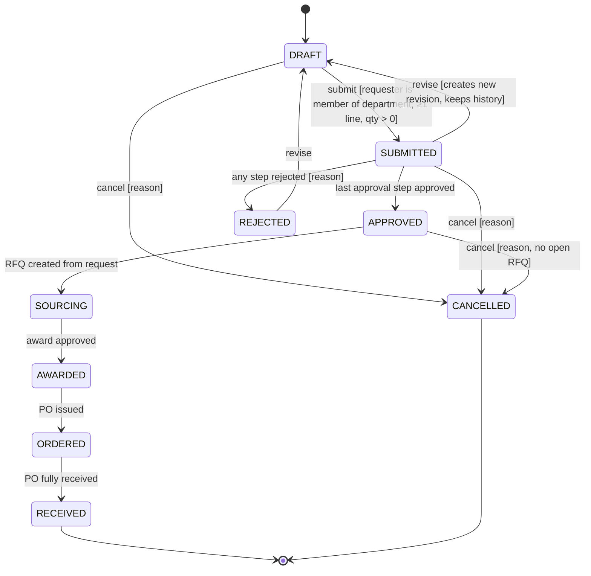
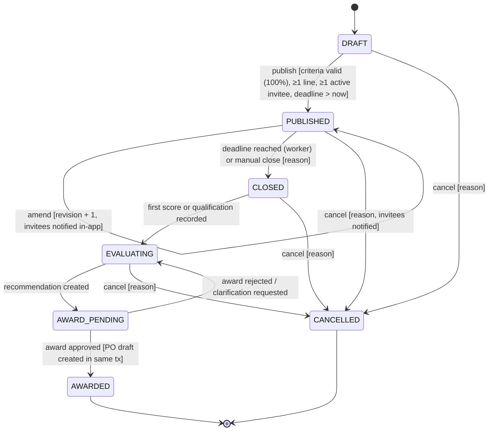
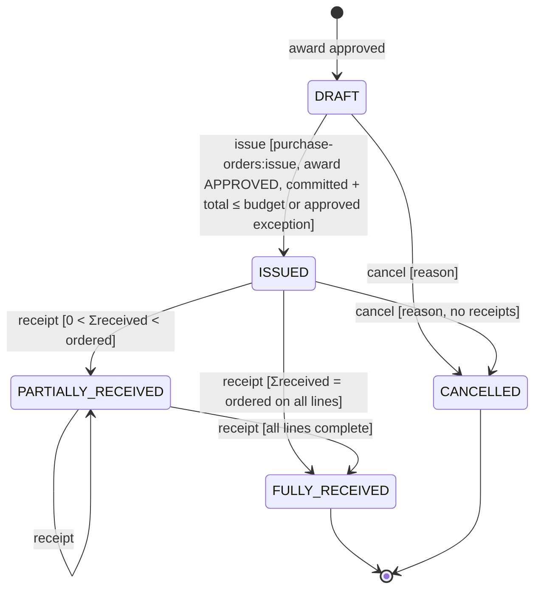

# System design

Module-by-module design for BidFlow. It refines the [architecture overview](../architecture/overview.md)
and the [data model](data-model.md). Status: ✅ implemented, ⏳ planned with ticket.

Related decisions: foundation ADRs
[0001](../adr/0001-record-architecture-decisions.md) ·
[0002](../adr/0002-modular-monolith-with-npm-workspaces.md) ·
[0003](../adr/0003-multi-tenancy-row-level-organization-scoping.md) ·
[0004](../adr/0004-postgresql-and-forward-only-sql-migrations.md) ·
[0005](../adr/0005-session-authentication-scrypt-and-csrf.md) ·
[0006](../adr/0006-api-conventions.md) ·
[0007](../adr/0007-role-based-access-control.md) ·
[0008](../adr/0008-append-only-audit-trail.md) ·
[0009](../adr/0009-configuration-and-secrets-management.md) ·
[0010](../adr/0010-testing-strategy.md) ·
[0011](../adr/0011-local-file-attachment-storage.md) ·
[0012](../adr/0012-in-app-notifications-and-background-worker.md);
product ADRs
[0013 money](../adr/0013-integer-money-basis-points-and-rounding.md) ·
[0014 scoring](../adr/0014-bid-comparison-and-scoring-model.md) ·
[0015 portal isolation](../adr/0015-supplier-portal-isolation-and-sealed-bids.md) ·
[0016 approvals](../adr/0016-approval-routing-and-segregation-of-duties.md) ·
[0017 state machines](../adr/0017-procurement-lifecycle-state-machines.md) ·
[0018 budget commitment](../adr/0018-budget-commitment-control.md).

## 1. Module catalogue

| Module            | Responsibility                                       | API prefix (`/api/v1`) | Status                                                                    |
| ----------------- | ---------------------------------------------------- | ---------------------- | ------------------------------------------------------------------------- |
| auth              | Login, session, logout, `/me`                        | `/auth`, `/me`         | ✅ BF-002                                                                 |
| health            | Liveness, readiness                                  | `/api/health`          | ✅ BF-003                                                                 |
| departments       | Departments with planning budgets                    | `/departments`         | ✅ list/create/get BF-009; ⏳ update, cost centers BF-013, budgets BF-014 |
| organization      | Currency, timezone, approval threshold               | `/organization`        | ⏳ BF-012                                                                 |
| users             | Users, roles, department memberships                 | `/users`               | ⏳ BF-015                                                                 |
| purchase-requests | Requests, lines, revisions, attachments              | `/purchase-requests`   | ⏳ BF-016–BF-018, BF-022                                                  |
| approvals         | Approval steps for requests and awards               | `/approvals`           | ⏳ BF-019, BF-020                                                         |
| suppliers         | Directory, status, supplier logins                   | `/suppliers`           | ⏳ BF-024, BF-025                                                         |
| rfqs              | RFQ events, criteria, publish, invitations, deadline | `/rfqs`                | ⏳ BF-027–BF-031                                                          |
| supplier portal   | Invited RFQs, bids, outcome                          | `/supplier`            | ⏳ BF-033–BF-035                                                          |
| evaluations       | Comparison, scores, qualification, recommendation    | `/rfqs/:id/...`        | ✅ engine BF-008; ⏳ endpoints BF-037, BF-038, BF-040                     |
| awards            | Award recommendations and snapshots                  | `/awards`              | ⏳ BF-040, BF-041                                                         |
| purchase-orders   | PO draft, issue, cancel, receipts                    | `/purchase-orders`     | ⏳ BF-043–BF-045                                                          |
| reports           | Dashboard, spend, performance, CSV                   | `/reports`             | ⏳ BF-048, BF-049                                                         |
| notifications     | In-app inbox, worker alerts                          | `/notifications`       | ⏳ BF-050                                                                 |
| audit             | Append-only events, viewer                           | `/audit-logs`          | ✅ writer BF-003; ⏳ viewer BF-051                                        |

## 2. Organization, departments and budgets (FR-01)

- **Organization** (`organizations`, implements PRD `buyer_organizations`) holds the fixed
  `default_currency` (✅ 0002). Timezone and `approval_threshold_minor` arrive with BF-012.
- **Departments** ✅: code (unique per organization, upper-case), name (unique per organization,
  case-insensitive), `budget_period` (`MONTHLY`/`QUARTERLY`), `budget_minor` (bigint minor units)
  and `currency` copied from the organization at creation — clients cannot choose it (the zod
  schema is `.strict()`). Creation is Buyer Admin only; reads are allowed for Admin, Requester,
  Procurement Officer and Approver; Receiving Clerk and Supplier User receive 403.
- **Budgets** ⏳ BF-014: a `budgets` table per department, period start and amount, plus a read
  model exposing three figures with definitions shown in the UI:
  - _Requested_ — sum of estimated totals of submitted, not-yet-decided requests.
  - _Approved_ — sum of approved request estimates not yet ordered.
  - _Committed_ — sum of issued, non-cancelled PO totals in the period (the control figure for ADR-0018).

Budget is a planning and approval control, not an accounting ledger (PRD FR-01).

## 3. Purchase requests (FR-02) ⏳

Request = department, requester, purpose, needed-by date, currency (organization currency),
optional supplier preference, line items (description, category, quantity `numeric(14,3)`,
unit, estimated unit price minor) and attachments. Codes (`PR-2026-0001`) come from a
per-organization counter row locked with `SELECT … FOR UPDATE` inside the creating transaction.

Submission writes an immutable revision snapshot (`purchase_request_revisions`, JSON + SHA-256
hash referenced from audit). Editing a submitted request creates a new draft revision; previous
decisions remain attached to the revision they decided.



## 4. Approvals (FR-02, FR-07) ⏳

`approval_steps(subject_type, subject_id, step_order, required_role, status, decided_by, …)`
serves both purchase requests and award recommendations. Rules (BF-019, ADR-0016) are a pure
function of the subject:

1. Department manager step for every request.
2. Finance (APPROVER) step when the estimate exceeds the organization threshold.
3. For awards: finance step when above threshold, over remaining budget, or not top-ranked.

Steps are decided strictly in `step_order`. The API rejects decisions by the subject's author
(no self-approval, B-02) and decisions on non-current steps.

```mermaid
sequenceDiagram
  autonumber
  actor R as Requester
  actor F as Approver / Finance
  participant API
  participant DB as PostgreSQL
  R->>API: POST /purchase-requests/:id/submit
  API->>DB: BEGIN; lock request (version check)
  API->>API: rules(estimate, threshold) → steps
  API->>DB: INSERT revision snapshot, approval_steps; status SUBMITTED; audit
  API->>DB: COMMIT; notification approval.requested
  F->>API: POST /approvals/:stepId/decision {approve} (Idempotency-Key)
  API->>DB: BEGIN; SELECT step FOR UPDATE
  API->>API: guard: step current, decider ≠ author, role matches
  API->>DB: UPDATE step; if last → request APPROVED; audit (ordered)
  API->>DB: COMMIT
  R->>API: POST /approvals/:stepId/decision (self-approval attempt)
  API-->>R: 403 FORBIDDEN (B-02)
```

## 5. Suppliers and the supplier portal (FR-03, FR-05) ⏳

- `supplier_organizations` are directory entries owned by a buyer organization (tenant column).
  Deactivation blocks new invitations and submissions but preserves existing bids.
- Supplier logins are `users` rows with role `SUPPLIER_USER` in the provisioning buyer
  organization, linked to exactly one supplier organization via `supplier_memberships`
  (ADR-0015). Provisioning is recorded as an in-app invitation; no email is sent.
- The `/supplier` namespace is the only surface a supplier can reach (`supplier-portal:access`).
  Every query joins `rfq_invitations` on the caller's supplier organization; unknown or
  uninvited ids return 404 (B-05, B-06). Supplier DTOs are separate types that cannot carry
  competitor names, scores, budgets or approval data.

## 6. RFQs (FR-04) ⏳

Created only from an `APPROVED` request; lines are snapshotted to `rfq_lines` and can be
clarified while `DRAFT`. Currency is fixed to the request currency. Criteria are validated with
the shared `validateCriteria` (B-09) on save and again on publish.



```mermaid
sequenceDiagram
  autonumber
  actor P as Procurement Officer
  participant API
  participant DB as PostgreSQL
  P->>API: POST /rfqs/:id/publish {version}
  API->>DB: BEGIN; SELECT rfq FOR UPDATE
  API->>API: guard status = DRAFT, version matches
  API->>API: validateCriteria(criteria) → 422 WEIGHTS_NOT_100_PERCENT if invalid
  API->>DB: status PUBLISHED, published_at = now(), lines frozen
  API->>DB: rfq_invitations → INVITED; notifications rfq.published; audit with lines hash
  API->>DB: COMMIT
```

Deadlines are stored as `timestamptz` (UTC) and compared with the database clock `now()`,
never the client clock (B-08). An admin-only demo endpoint shifts `deadline_at` into the past
for automated tests and is disabled when `NODE_ENV=production` (BF-031).

## 7. Bidding (FR-05) ⏳

One current bid per `(rfq_id, supplier_org_id)`; each save inserts a new row in
`supplier_bid_revisions` and repoints the bid, so earlier versions remain readable.

```mermaid
stateDiagram-v2
  [*] --> DRAFT
  DRAFT --> DRAFT: save [now() < deadline; new revision]
  DRAFT --> SUBMITTED: submit [now() < deadline, all mandatory lines priced, supplier active]
  SUBMITTED --> SUBMITTED: resubmit edit [now() < deadline; new revision]
  SUBMITTED --> WITHDRAWN: withdraw [now() < deadline]
  WITHDRAWN --> DRAFT: reopen [now() < deadline]
  SUBMITTED --> [*]: RFQ closed (read-only)
  WITHDRAWN --> [*]: RFQ closed (cannot win)
```



```mermaid
sequenceDiagram
  autonumber
  actor S as Supplier User
  participant API
  participant DB as PostgreSQL
  S->>API: POST /supplier/bids/:id/submit
  API->>DB: BEGIN; SELECT bid JOIN invitation (caller's supplier org) FOR UPDATE
  alt not caller's bid / not invited
    API-->>S: 404 (no content)
  end
  API->>DB: SELECT now() < rfq.deadline_at AND rfq.status = PUBLISHED
  alt deadline passed
    API-->>S: 409 INVALID_STATE_TRANSITION "Deadline passed" (B-08)
  end
  API->>DB: status SUBMITTED, submitted_at = now(), revision snapshot hash; audit
  API->>DB: COMMIT; notify procurement bid.submitted
  API-->>S: 200 {revision, submittedAt}
```

## 8. Evaluation engine (FR-06) ✅ engine · ⏳ endpoints

Implemented in `packages/shared/src/domain/` as pure functions (ADR-0014), so the API comparison
endpoint (BF-037) and the matrix screen (BF-039) share one implementation.

- `computeBidTotals` — line total = unit price × quantity (milli-units) computed in BigInt and
  rounded once (ROUND HALF UP) per line; bid total = sum of rounded line totals; delivery
  promise = max line lead time. A total exists only when every RFQ line is quoted in the RFQ
  currency; cross-currency bids are flagged `CURRENCY_MISMATCH`, never converted.
- Ineligibility reasons: `WITHDRAWN`, `DISQUALIFIED`, `TECHNICALLY_NON_COMPLIANT` (any line
  non-compliant), `CURRENCY_MISMATCH`, `INCOMPLETE`, `NON_POSITIVE_TOTAL`.
- **Lowest-priced** = cheapest complete, same-currency, non-withdrawn bid, even if unqualified.
  **Lowest qualified** = cheapest bid with no ineligibility reason; only it normalizes price (B-10).
- Scores in parts per million of 100 points:
  - price: `lowest_qualified × weight_bps × 100 / bid_total`
  - qualitative: `Σscores × weight_bps / evaluator_count` (mean of 0–100 scores)
  - each criterion rounded once to 1 ppm; display rounding (`formatScore`) to 2 decimals.
- Only qualified bids get a total and a rank. Ranking: score desc → total asc → max lead days
  asc → submitted_at asc → bid id. Missing qualitative scores make the result `provisional`.
- `assessRecommendation` — blocks unqualified bids and provisional evaluations; flags
  non-top-ranked choices as `requiresJustification` (B-11).

PRD §8 example (verified in `bid-comparison.test.ts`): Metro Electrical USD 37,400.00 is the
lowest-priced bid but non-compliant; Allied Facilities USD 41,000.00 is the lowest qualified bid
and ranks first (93.00); Peak HVAC USD 41,400.00 ranks second (92.42).

## 9. Awards and purchase-order draft (FR-07) ⏳

```mermaid
stateDiagram-v2
  [*] --> PENDING_APPROVAL: recommend [eligible; justification if not top-ranked]
  PENDING_APPROVAL --> CLARIFICATION_REQUESTED: approver requests clarification
  CLARIFICATION_REQUESTED --> PENDING_APPROVAL: author responds
  PENDING_APPROVAL --> APPROVED: all steps approved [approver ≠ author]
  PENDING_APPROVAL --> REJECTED: step rejected [reason]
  APPROVED --> [*]
  REJECTED --> [*]
```

```mermaid
sequenceDiagram
  autonumber
  actor P as Procurement Officer
  actor F as Approver / Finance
  participant API
  participant DB as PostgreSQL
  P->>API: GET /rfqs/:id/comparison
  API->>DB: load submitted bids, qualifications, scores (status ≥ CLOSED only)
  API->>API: compareBids(...)
  P->>API: POST /rfqs/:id/recommend-award {bidId, justification}
  API->>API: assessRecommendation → eligible? requiresJustification?
  API->>DB: INSERT award_recommendations (award_snapshot_json: bid revision, criteria, scores, hash); steps; audit
  F->>API: POST /approvals/:stepId/decision {approve} Idempotency-Key: k1
  API->>DB: BEGIN; step FOR UPDATE; guard approver ≠ author
  API->>DB: award APPROVED; rfq AWARDED; request AWARDED
  API->>DB: INSERT purchase_orders (award_id UNIQUE) + lines from snapshot; audit
  API->>DB: COMMIT
  F->>API: same POST again (retry), Idempotency-Key: k1
  API-->>F: stored original response; no second PO (B-12, B-17)
```

## 10. Purchase orders and budget commitment (FR-08, goal 5) ⏳



```mermaid
sequenceDiagram
  autonumber
  actor P as Procurement Officer
  participant API
  participant DB as PostgreSQL
  P->>API: POST /purchase-orders/:id/issue {version}
  API->>API: requirePermission('purchase-orders:issue') — else 403 + audit (B-13)
  API->>DB: BEGIN
  API->>DB: SELECT po FOR UPDATE (status DRAFT, version)
  API->>DB: SELECT budget row FOR UPDATE (department, period)
  API->>DB: SELECT Σ committed for period
  alt committed + po.total > budget and no approved exception
    API-->>P: 409 "Over budget: finance exception required" (ROLLBACK)
  end
  API->>DB: po ISSUED, issued_at, terms_snapshot_json; request ORDERED; audit
  API->>DB: COMMIT
```

Locking the budget row serializes concurrent issues against the same department period, so two
POs cannot both pass the check (ADR-0018).

## 11. Receipts (FR-08) ⏳

```mermaid
sequenceDiagram
  autonumber
  actor C as Receiving Clerk
  participant API
  participant DB as PostgreSQL
  C->>API: POST /purchase-orders/:id/receipts {lines:[{poLineId, qty}]} Idempotency-Key
  API->>DB: BEGIN; SELECT po FOR UPDATE; SELECT po lines FOR UPDATE
  API->>API: for each line: already + qty ≤ ordered ?
  alt over-receipt
    API-->>C: 409 "Received quantity exceeds ordered" (ROLLBACK; totals unchanged, B-15)
  end
  API->>DB: INSERT receipts, receipt_lines; recompute PO status; audit
  API->>DB: COMMIT
  API-->>C: 201 {outstanding per line, poStatus} (B-14)
```

## 12. Reports and dashboard (FR-09) ⏳

Read-only SQL aggregates over tenant-scoped tables (BF-048, BF-049): committed value, pending
approvals, RFQs closing within 72 h, outstanding receipts, late deliveries, spend by
department/category/supplier, average bids per RFQ, cycle time (published → awarded). Ratios
with a zero denominator return `null` and render as `Not available`. CSV export streams rows
using `formatMinorUnits` (plain decimals, no float conversion).

## 13. Notifications and background jobs (FR-09, ADR-0012) ⏳

| Trigger                   | Source                                | Recipients                              |
| ------------------------- | ------------------------------------- | --------------------------------------- |
| Approval requested        | approvals service (in tx, outbox row) | step role holders                       |
| RFQ published / amended   | rfqs service                          | invited supplier users                  |
| Bid submitted             | supplier portal                       | procurement officers                    |
| RFQ closing soon / closed | worker, every minute                  | procurement, invitees                   |
| Award decided             | approvals                             | author, winning supplier (outcome only) |
| Delivery overdue          | worker, hourly                        | receiving clerks, procurement           |

The worker is a separate process from the same codebase (BF-050). It takes a PostgreSQL advisory
lock so only one instance runs, uses `UPDATE … WHERE status = 'PUBLISHED' AND deadline_at <= now()`
for idempotent closes, and de-duplicates notifications with a unique `(recipient, kind, subject_id)`
key.

## 14. File storage (ADR-0011) ⏳

Uploads go to `UPLOAD_DIR` under random UUID names (no user-controlled paths), with an extension
and sniffed MIME allow-list (PDF, PNG, JPEG, XLSX, DOCX, CSV) and `UPLOAD_MAX_BYTES` (10 MB).
`attachments` stores owner type/id, organization, original name, size, SHA-256 and uploader.
Downloads check record-level access then stream with `Content-Disposition: attachment`.

## 15. Audit (FR-10, ADR-0008) ✅ writer

`recordAudit(tx, event)` inserts into `audit_events` within the business transaction, so an event
exists if and only if the change committed (proven for `department.created`). Events carry actor,
organization, action, entity type/id, request id and metadata; snapshot-bearing events (request
submission, bid submission, award, PO issue) include a SHA-256 of the snapshot JSON. The viewer
API is BF-051.

## 16. Concurrency and idempotency

| Risk                            | Control                                                                                            | Status                                      |
| ------------------------------- | -------------------------------------------------------------------------------------------------- | ------------------------------------------- |
| Lost update on editable records | `version` column; `UPDATE … WHERE id = $1 AND organization_id = $2 AND version = $3`; 0 rows → 409 | ✅ column on departments; ⏳ BF-013, BF-018 |
| Duplicate codes                 | `UNIQUE (organization_id, code)` on departments, requests, RFQs, POs                               | ✅ departments                              |
| Duplicate invitation            | `UNIQUE (rfq_id, supplier_org_id)`                                                                 | ⏳ BF-030                                   |
| Two current bids                | `UNIQUE (rfq_id, supplier_org_id)` on `supplier_bids`                                              | ⏳ BF-034                                   |
| Two POs for one award           | `UNIQUE (award_id)` on `purchase_orders`, created in the approval tx                               | ⏳ BF-041                                   |
| Concurrent over-budget issue    | `SELECT … FOR UPDATE` on budget row before commitment check                                        | ⏳ BF-043                                   |
| Concurrent over-receipt         | `FOR UPDATE` on PO lines; CHECK `qty_received > 0`                                                 | ⏳ BF-045                                   |
| Client retries                  | `Idempotency-Key` table `(organization_id, key)` with request hash and stored response, 24 h TTL   | ⏳ BF-047                                   |
| Deadline races                  | Comparison in SQL with `now()` inside the submit transaction                                       | ⏳ BF-035                                   |

## 17. Error handling

All errors use the envelope from ADR-0006. `AppError` codes map to HTTP status
(`VALIDATION_FAILED` 422, `FORBIDDEN` 403, `NOT_FOUND` 404, `CONFLICT` / `INVALID_STATE_TRANSITION`
409, `NOT_IMPLEMENTED` 501). Shared-domain `DomainError`s (e.g. `INVALID_CRITERIA`,
`AMOUNT_OVERFLOW`) become 422 with `details.domainCode` and `details.issues` ✅. Unknown errors are
logged with the request id and returned as a generic 500. Cross-tenant ids always yield 404,
never 403, so existence is not disclosed.

## 18. Performance and indexing

Every list query starts with `organization_id`; indexes therefore lead with it:

| Table                | Index                                                                                                           | Purpose                        |
| -------------------- | --------------------------------------------------------------------------------------------------------------- | ------------------------------ |
| departments ✅       | `(organization_id, code)` unique, `(organization_id, lower(name))` unique, `(organization_id, is_active, code)` | List, search, uniqueness       |
| purchase_requests ⏳ | `(organization_id, status, created_at DESC)`, `(organization_id, department_id)`                                | Filtered lists, budget rollups |
| approval_steps ⏳    | `(organization_id, status, required_role)`, `(subject_type, subject_id, step_order)`                            | Inbox, ordered decisions       |
| rfqs ⏳              | `(organization_id, status, deadline_at)`                                                                        | Stage tabs, worker close scan  |
| rfq_invitations ⏳   | `(supplier_org_id, status)`                                                                                     | Supplier portal list           |
| supplier_bids ⏳     | `(rfq_id, status)`                                                                                              | Comparison load                |
| purchase_orders ⏳   | `(organization_id, status, issued_at)`, unique `(award_id)`                                                     | Lists, dashboard               |
| audit_events ✅      | `(organization_id, occurred_at DESC)`, `(entity_type, entity_id)`                                               | Viewer, entity history         |

Lists are paginated (max 100). The comparison loads one RFQ's bids in two queries (bids + lines)
and runs the O(bids × lines) engine in memory, well inside the 300 ms p95 target for 20 × 200.

## 19. Future scaling path

1. Serve the SPA from a CDN-capable reverse proxy; run N stateless API instances.
2. Move reports to a read replica; add materialized views for spend rollups refreshed by the worker.
3. Partition `audit_events` by month once it exceeds ~50 M rows.
4. Replace polling notifications with server-sent events.
5. Move attachments to S3-compatible object storage behind the same storage interface (ADR-0011).
6. Optionally enforce tenancy additionally with PostgreSQL row-level security policies (ADR-0003).
