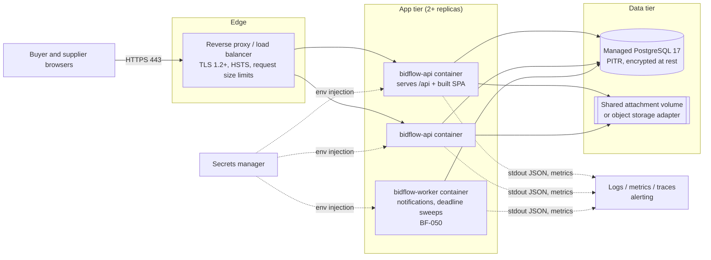
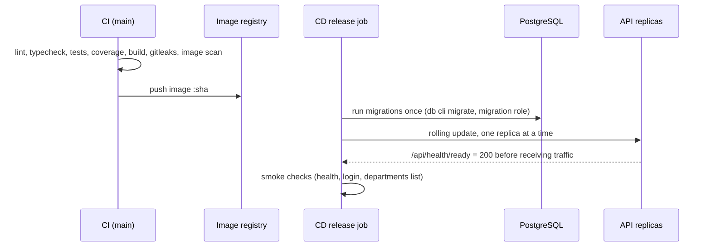

# Deployment (Planned)

> **Status: PLANNED.** Nothing in this document is implemented yet. It describes the target production topology delivered by **BF-059** and constrains earlier work so it stays deployable. Today BidFlow runs locally only via `./run.sh` ([runbook](runbook.md)).

Related: [ADR-0004](../adr/0004-postgresql-and-forward-only-sql-migrations.md), [ADR-0009](../adr/0009-configuration-and-secrets-management.md), [ADR-0011](../adr/0011-local-file-attachment-storage.md), [quality attributes](../architecture/quality-attributes.md).

## 1. Target topology

## 2. Container image

- Multi-stage build: `npm ci` + `npm run build` in a builder stage; runtime stage on a slim Node 22 image with production dependencies only.
- Runtime contains `apps/api/dist`, `apps/api/migrations` and the built web assets (`apps/web/dist`) served by the API under `/` with long-cache hashed assets.
- Runs as a non-root user, read-only root filesystem except the attachment mount, `HEALTHCHECK` on `/api/health/live`.
- No secrets, `.env` files or demo seed execution in the image; `NODE_ENV=production` makes the seed and reset commands refuse to run.
- Image tagged with the git SHA; scanned for vulnerabilities in CI before push.

## 3. Reverse proxy and TLS

- TLS terminated at the proxy with managed certificates; HTTP redirects to HTTPS; HSTS enabled.
- Proxy forwards to the API on a private network; the API trusts `X-Forwarded-*` only from the proxy (`trust proxy` restricted to the proxy hop).
- `APP_ORIGIN` set to the public origin so CSRF origin checks pass; session cookies get `Secure` automatically in production.
- Body size limit aligned with `UPLOAD_MAX_BYTES`; connection and header timeouts set at the proxy.

## 4. Database

- Managed PostgreSQL 17 with automated daily snapshots, point-in-time recovery (WAL retention 14 days), encryption at rest and TLS in transit.
- Two database roles: a migration role (DDL) used only by the release step, and an application role with `SELECT/INSERT/UPDATE/DELETE` on business tables and `SELECT/INSERT` only on `audit_events` (append-only, [ADR-0008](../adr/0008-append-only-audit-trail.md)).
- `DATABASE_POOL_MAX` sized so `replicas × pool ≤ max_connections − headroom`.

## 5. Secrets and configuration

- `SESSION_SECRET`, `DATABASE_URL` and future keys come from a secrets manager injected as environment variables at container start.
- Environment validation (`apps/api/src/config/env.ts`) fails fast on missing or placeholder secrets.
- Secret rotation: rotating `SESSION_SECRET` invalidates CSRF tokens (users re-authenticate); planned dual-key verification window if needed.

## 6. Release pipeline

- **Migrations as a release step:** `node dist/db/cli.js migrate` runs once per release, before new replicas start, with a lock-timeout. The forward-only runner with checksums refuses edited migrations.
- **Expand/contract:** schema changes ship in two releases: expand (add nullable columns/tables, backfill, dual-write) then contract (drop old paths) after all replicas run the new code. Never rename or drop a column used by the running version.
- **Zero-downtime rolling deploy:** readiness gating on `/api/health/ready`, `SIGTERM` handling already closes the HTTP server and the pool within 10 s; the proxy drains connections.
- **Rollback:** redeploy the previous image tag; because migrations are expand-first, the previous version remains compatible.

## 7. Observability

| Signal  | Plan                                                                                                                                                                                |
| ------- | ----------------------------------------------------------------------------------------------------------------------------------------------------------------------------------- |
| Logs    | pino JSON to stdout, shipped to central log storage; retain 30 days; redaction already in place; search by `X-Request-Id`                                                           |
| Metrics | HTTP rate, error rate and p95 latency per route; DB pool usage; event loop lag; business counters (bids submitted, POs issued, receipts)                                            |
| Traces  | OpenTelemetry instrumentation for Express and `pg`, request id propagated as trace attribute                                                                                        |
| Alerts  | Readiness failing > 2 min; 5xx rate > 1 % over 5 min; p95 above targets in [quality attributes](../architecture/quality-attributes.md); worker heartbeat missing; DB storage > 80 % |
| Audit   | `audit_events` exported nightly to immutable storage for long-term retention                                                                                                        |

## 8. Backup policy

| Item          | Policy                                                                                          | Target                                        |
| ------------- | ----------------------------------------------------------------------------------------------- | --------------------------------------------- |
| PostgreSQL    | Managed PITR + daily snapshots retained 35 days; monthly snapshot retained 12 months            | RPO ≤ 15 min, RTO ≤ 4 h                       |
| Attachments   | Versioned volume/object storage, daily copy to a second location                                | Same RPO as database for metadata consistency |
| Restore drill | Quarterly restore into a staging environment, verified with `schema_migrations` and smoke tests | Documented in the runbook                     |

## 9. Exit criteria for BF-059

- Image builds reproducibly, runs as non-root with no dev dependencies.
- Migrations run once per release before traffic shifts; failure aborts the release.
- No secrets baked into the image; startup fails on placeholder secrets.
- Rolling deploy completes with zero failed requests in a smoke run.
