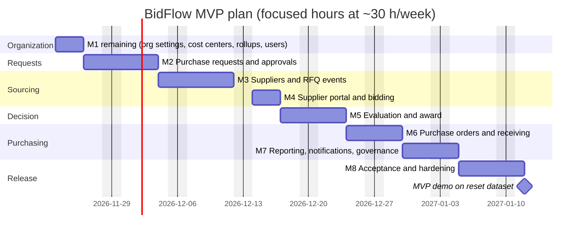

# Roadmap

BidFlow is delivered in nine milestones that follow the PRD §10 build sequence. The integrated
MVP must demonstrate one complete flow: request → approval → RFQ → three supplier bids →
evaluation → award approval → purchase order → partial/full receipt. If time is constrained,
visual polish and advanced budget breakdowns are cut — never integrity checks (PRD §10).

Estimates are focused engineering hours from [backlog.md](backlog.md) (59 tickets, 230 h total,
34 h done, **14.8 % complete**). The schedule below assumes one engineer at ~30 focused hours per
week starting 2026-11-23; parallel staffing shortens M3–M7.

## Milestones

| Milestone                             | Goal                                                  | Exit criteria                                                                                                                                |         Estimate | Status        |
| ------------------------------------- | ----------------------------------------------------- | -------------------------------------------------------------------------------------------------------------------------------------------- | ---------------: | ------------- |
| M0 Foundation                         | Runnable, secure skeleton with the real actor model   | `./run.sh` starts a fresh clone; auth, CSRF, migrations, audit, pending surface; CI green                                                    |             17 h | ✅ Done       |
| M1 Organization, budgets, domain core | Departments with budgets; money and comparison engine | Departments CRUD tenant-isolated and audited ✅; money + engine at 100 % coverage ✅; org settings, cost centers, budget rollups, user admin | 33 h (17 h done) | ◐ In progress |
| M2 Requests and approvals             | Purchase requests with real approvals                 | B-01, B-02, B-03 pass at API level; no self-approval enforced in SQL-backed workflow                                                         |             33 h | ⏳ Pending    |
| M3 Suppliers and RFQs                 | Structured RFQ events                                 | RFQ from approved request; criteria validated (B-09); publish freezes lines (B-04); server-side deadline (B-08)                              |             35 h | ⏳ Pending    |
| M4 Supplier portal                    | Confidential bidding                                  | B-05, B-06, B-07 pass, including direct API calls                                                                                            |             17 h | ⏳ Pending    |
| M5 Evaluation and award               | Objective comparison and approved award               | Comparison on persisted bids; B-10, B-11, B-12 pass; snapshot stored                                                                         |             26 h | ⏳ Pending    |
| M6 POs and receiving                  | Controlled purchasing                                 | B-13, B-14, B-15, B-17 pass; over-budget PO blocked                                                                                          |             20 h | ⏳ Pending    |
| M7 Reporting and governance           | Visibility and traceability                           | Dashboard, reports with CSV, notifications, audit viewer                                                                                     |             19 h | ⏳ Pending    |
| M8 Acceptance and hardening           | Prove the MVP                                         | Full PRD §8 seed; Playwright B-01..B-18 green on reset data; ASVS sweep; WCAG pass; deploy pipeline                                          |             30 h | ⏳ Pending    |

## Schedule

M0 and the M1 domain core were completed before the planning start date and are omitted.

## Sequencing rules

- Backend authorization first, then workflow, then screens (PRD implementation note).
- Each milestone ends with its acceptance scenarios automated at API level; the Playwright suite
  in M8 re-runs them end to end.
- Post-MVP (PRD §12): split awards, blanket POs, multi-currency with approved FX sources, tax
  localization, external invitation emails, vendor self-registration, ERP integrations, supplier
  performance weighting, negotiated rounds, invoice matching. Not scheduled.
