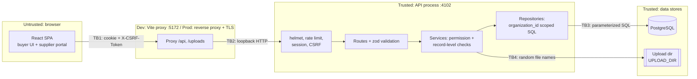

# Threat Model

**Scope:** BidFlow MVP: buyer workspace, supplier portal, API, PostgreSQL and local attachment storage.
**Method:** STRIDE per component, mapped to OWASP ASVS 4.0 Level 2.
**Status:** Foundation controls and the departments slice are implemented. Controls for purchase requests, RFQs, bidding, award, POs and receipts are designed here and tracked as pending tickets.

Related decisions: [ADR-0003](../adr/0003-multi-tenancy-row-level-organization-scoping.md),
[ADR-0005](../adr/0005-session-authentication-scrypt-and-csrf.md),
[ADR-0007](../adr/0007-role-based-access-control.md),
[ADR-0008](../adr/0008-append-only-audit-trail.md),
[ADR-0011](../adr/0011-local-file-attachment-storage.md),
[ADR-0015](../adr/0015-supplier-portal-isolation-and-sealed-bids.md),
[ADR-0018](../adr/0018-budget-commitment-control.md).

## 1. Assets

| Asset                                                    | Why it matters                                                                             | Confidentiality | Integrity | Exists today               |
| -------------------------------------------------------- | ------------------------------------------------------------------------------------------ | --------------- | --------- | -------------------------- |
| Supplier bids before close (prices, lead times, notes)   | Leaking one supplier's price to a competitor or buyer insider breaks a fair sourcing event | Critical        | Critical  | ⏳ BF-034                  |
| Evaluation scores, qualifications, rationale             | Internal decision support; suppliers must never see them                                   | High            | High      | ⏳ BF-038                  |
| Department budgets and committed spend                   | Commercially sensitive; drives the over-budget control                                     | High            | High      | ✅ departments (BF-009)    |
| Award snapshots and PO terms                             | Legal and financial record; must trace to the original bid                                 | Medium          | Critical  | ⏳ BF-040, BF-043          |
| Receipts and outstanding quantities                      | Drive PO state and future invoice matching                                                 | Low             | Critical  | ⏳ BF-045                  |
| Credentials and session tokens                           | Account takeover gives full role power                                                     | Critical        | Critical  | ✅ BF-002                  |
| Audit trail (`audit_events`)                             | Non-repudiation for approvals, awards, PO issue                                            | Medium          | Critical  | ✅ table + writer (BF-003) |
| Attachments (specifications, bid documents)              | May contain proprietary designs or pricing                                                 | High            | High      | ⏳ BF-022                  |
| Configuration secrets (`SESSION_SECRET`, `DATABASE_URL`) | Forge CSRF tokens, reach the database                                                      | Critical        | Critical  | ✅ BF-001                  |

## 2. Actors

| Actor                                | Legitimate capability                                         | Threat posture                                                                                                          |
| ------------------------------------ | ------------------------------------------------------------- | ----------------------------------------------------------------------------------------------------------------------- |
| Buyer Organization Admin             | Settings, users, departments, all records of one organization | Trusted but audited; compromise is high impact                                                                          |
| Requester                            | Creates purchase requests                                     | May try to self-approve (B-02) or read sealed bids                                                                      |
| Procurement Officer                  | RFQs, suppliers, comparison after close, award drafts         | May try to bypass approval or peek at bids before close                                                                 |
| Approver / Finance                   | Approves requests, exceptions and awards                      | May try to alter submitted bids or approve own recommendation                                                           |
| Receiving Clerk                      | Records deliveries                                            | May try to over-receive or change commercial terms                                                                      |
| Supplier User (honest)               | Own invitations and own bid                                   | Needs confidentiality from competitors                                                                                  |
| Malicious supplier                   | Same session as above                                         | Enumerates RFQ/bid ids, reads competitor bids (B-05, B-06), submits after deadline (B-08), submits for another supplier |
| Foreign tenant                       | Valid user of another buyer organization                      | Attempts cross-tenant reads/writes by id (B-18)                                                                         |
| Anonymous attacker                   | Network access only                                           | Credential stuffing, CSRF, injection, upload abuse                                                                      |
| Insider with database or host access | Operator                                                      | Tampering with audit rows or bids; mitigated by append-only policy and backups, not fully preventable in MVP            |

## 3. Trust boundaries

- **TB1** All input from the browser is untrusted, including the role shown in the UI. Navigation hiding is cosmetic; the API decides.
- **TB2** The API trusts `X-Forwarded-*` only from loopback (`trust proxy = loopback`).
- **TB3** Tenant identity comes from the session row, never from request bodies or query strings.
- **TB4** Uploaded bytes never execute and are never served from a path chosen by the client (pending BF-022).

## 4. STRIDE analysis

Status: ✅ implemented, ⏳ pending (ticket).

### 4.1 Authentication and sessions

| Threat                                                | STRIDE | Mitigation                                                                                     | Status                                                                         |
| ----------------------------------------------------- | ------ | ---------------------------------------------------------------------------------------------- | ------------------------------------------------------------------------------ |
| Credential stuffing / brute force on login            | S      | Login rate limit (`AUTH_RATE_LIMIT_MAX` per window) plus global API limiter                    | ✅ BF-002                                                                      |
| Offline cracking of stolen hashes                     | I      | scrypt N=32768, r=8, p=1, 16-byte salt per hash                                                | ✅ BF-002                                                                      |
| Account enumeration via messages or timing            | I      | Identical 401 for unknown, inactive and wrong-password; dummy-hash comparison equalises timing | ✅ BF-002                                                                      |
| Session theft from database dump                      | S      | Only SHA-256 of the 256-bit token is stored                                                    | ✅ BF-002                                                                      |
| Session theft via XSS                                 | S      | HttpOnly, SameSite=Lax cookie; React escaping; helmet CSP defaults                             | ✅ BF-002                                                                      |
| Long-lived sessions after role change or deactivation | E      | Session lookup joins `users.is_active`; TTL `SESSION_TTL_MINUTES`; expired-session sweep       | ✅ BF-002; revoke-on-password-change ⏳ BF-052, revoke-on-deactivate ⏳ BF-015 |
| Weak passwords                                        | S      | Minimum 12 characters at hash time                                                             | ✅; password change UI ⏳ BF-052                                               |

### 4.2 CSRF and browser

| Threat                                           | STRIDE | Mitigation                                                                                                              | Status                                         |
| ------------------------------------------------ | ------ | ----------------------------------------------------------------------------------------------------------------------- | ---------------------------------------------- |
| Cross-site state change using the session cookie | T      | SameSite=Lax + Origin/Referer must equal `APP_ORIGIN` + `X-CSRF-Token` = HMAC-SHA256(secret, session) on unsafe methods | ✅ BF-002                                      |
| Clickjacking on approval or award buttons        | T      | helmet `X-Frame-Options`/`frame-ancestors`                                                                              | ✅                                             |
| MIME sniffing of served files                    | T      | `X-Content-Type-Options: nosniff`                                                                                       | ✅; attachment `Content-Disposition` ⏳ BF-022 |

### 4.3 API modules (buyer side)

| Threat                                                      | STRIDE | Mitigation                                                                                                                   | Status                                                                  |
| ----------------------------------------------------------- | ------ | ---------------------------------------------------------------------------------------------------------------------------- | ----------------------------------------------------------------------- |
| Cross-tenant read by guessing ids (B-18)                    | I      | Every repository statement filters `organization_id = session.organizationId`; not-found and foreign records both return 404 | ✅ departments; ⏳ per module (BF-017, BF-027, BF-044) and sweep BF-057 |
| Role escalation by calling hidden endpoints                 | E      | `requirePermission` from the shared matrix on every route; services re-check (defence in depth)                              | ✅ BF-004, BF-009                                                       |
| Probing unbuilt endpoints                                   | I      | Pending routes enforce auth and permission **before** answering 501 + ticket                                                 | ✅ BF-006                                                               |
| Invalid role values written directly                        | T      | `users_role_check` CHECK constraint (migration 0002)                                                                         | ✅ BF-004                                                               |
| Mass assignment (e.g. `organizationId`, `currency` in body) | T      | zod `.strict()` schemas; server derives tenant and currency                                                                  | ✅ departments                                                          |
| SQL injection                                               | T      | Parameterized queries only; LIKE wildcards escaped                                                                           | ✅                                                                      |
| Self-approval (B-02)                                        | E      | Approval service rejects decisions by the subject author                                                                     | ⏳ BF-020                                                               |
| Approval bypass on PO issue (B-13)                          | E      | PO issue checks approved award + permission in one transaction; denied attempts audited                                      | ⏳ BF-043                                                               |
| Duplicate financial records on retry (B-17)                 | T      | Idempotency keys + unique constraints (one PO per award)                                                                     | ⏳ BF-047, BF-041                                                       |
| Verbose errors leaking SQL/stack                            | I      | Error handler maps unknown errors to generic 500; pino logs details server-side with request id                              | ✅                                                                      |

### 4.4 Supplier portal

| Threat                                                  | STRIDE | Mitigation                                                                                               | Status                                                           |
| ------------------------------------------------------- | ------ | -------------------------------------------------------------------------------------------------------- | ---------------------------------------------------------------- |
| Uninvited supplier opens RFQ id (B-05)                  | I      | Portal queries join `rfq_invitations` on the caller's supplier organization; miss = 404                  | ⏳ BF-033                                                        |
| Supplier A reads supplier B's bid (B-06)                | I      | Bid queries filter by caller's `supplier_org_id`; no buyer-side endpoint is reachable by `SUPPLIER_USER` | ✅ permission matrix denies buyer routes; ⏳ record-level BF-033 |
| Submitting a bid on behalf of another supplier          | S      | Supplier id taken from session membership, never from body                                               | ⏳ BF-034                                                        |
| Late submission with manipulated client clock (B-08)    | T      | Server clock in UTC compared with `deadline_at` inside the submit transaction                            | ⏳ BF-031, BF-035                                                |
| Leaking competitor names, scores or budgets in payloads | I      | Dedicated supplier DTOs; contract tests assert absent fields                                             | ⏳ BF-033                                                        |
| Editing a bid after close                               | T      | Status check + row lock on submit/withdraw; revisions append-only                                        | ⏳ BF-034, BF-035                                                |

### 4.5 Comparison and evaluation

| Threat                                        | STRIDE | Mitigation                                                                                         | Status                           |
| --------------------------------------------- | ------ | -------------------------------------------------------------------------------------------------- | -------------------------------- |
| Sealed bids exposed before close              | I      | Comparison endpoint returns 409 until RFQ is CLOSED; list queries exclude bid amounts before close | ⏳ BF-037                        |
| Manipulated scoring (floats, hidden rounding) | T      | Pure deterministic engine, integer minor units and ppm, single documented rounding rule            | ✅ BF-007, BF-008                |
| Disqualified bid still winning (B-10)         | T      | Engine excludes unqualified bids from normalization and ranking; recommendation blocked            | ✅ engine; ⏳ persistence BF-038 |
| History rewritten after award                 | R/T    | Award snapshot JSON of bid revision, criteria and scores                                           | ⏳ BF-040                        |

### 4.6 Purchase orders and receipts

| Threat                                    | STRIDE | Mitigation                                                                           | Status                                                           |
| ----------------------------------------- | ------ | ------------------------------------------------------------------------------------ | ---------------------------------------------------------------- |
| Over-budget PO issued silently            | T      | Budget commitment check with row lock at issue time                                  | ⏳ BF-043 ([ADR-0018](../adr/0018-budget-commitment-control.md)) |
| Over-receipt (B-15)                       | T      | Cumulative quantity check in the receipt transaction; reject leaves totals unchanged | ⏳ BF-045                                                        |
| Changing issued PO prices                 | T      | Issued lines immutable; changes require revision or cancel/reissue                   | ⏳ BF-043                                                        |
| Receiving clerk altering commercial terms | E      | Clerk has only `receipts:record` and `purchase-orders:read`                          | ✅ matrix                                                        |

### 4.7 Audit trail

| Threat                            | STRIDE | Mitigation                                                                    | Status                       |
| --------------------------------- | ------ | ----------------------------------------------------------------------------- | ---------------------------- |
| Action without trace              | R      | Audit row written in the same transaction as the change; login audited        | ✅ departments, login        |
| Tampering with audit rows         | T      | Application never updates/deletes; production DB role gets INSERT/SELECT only | ✅ code; ⏳ DB grants BF-059 |
| Audit data leaking across tenants | I      | Audit viewer scoped by organization                                           | ⏳ BF-051                    |

### 4.8 Uploads

| Threat                            | STRIDE | Mitigation                                                                  | Status                           |
| --------------------------------- | ------ | --------------------------------------------------------------------------- | -------------------------------- |
| Malicious file type / stored XSS  | T/E    | Extension + MIME allow-list, served as attachment with nosniff              | ⏳ BF-022                        |
| Path traversal                    | T      | Random storage names; client file name stored only as metadata              | ⏳ BF-022                        |
| Disk exhaustion                   | D      | `UPLOAD_MAX_BYTES` (10 MiB default), per-record limits                      | ✅ config; ⏳ enforcement BF-022 |
| Downloading another tenant's file | I      | Download resolves owning record and runs the same tenant + permission check | ⏳ BF-022                        |

### 4.9 Seed and configuration

| Threat                              | STRIDE | Mitigation                                                                                              | Status    |
| ----------------------------------- | ------ | ------------------------------------------------------------------------------------------------------- | --------- |
| Demo accounts in production         | S      | Seed refuses `NODE_ENV=production`; credentials documented as development-only                          | ✅ BF-005 |
| Placeholder or short session secret | S      | Env validation: ≥32 chars, placeholder rejected in production; `run.sh` generates a random local secret | ✅ BF-001 |
| Secrets committed to git            | I      | Only `.env.example`; `.env` ignored; gitleaks in CI                                                     | ✅ BF-001 |
| Destructive reset in production     | D      | `run.sh reset` and `db reset` refuse `NODE_ENV=production`                                              | ✅        |
| Secrets in logs                     | I      | pino redaction of cookies, auth headers, CSRF header, passwords                                         | ✅        |

## 5. OWASP ASVS L2 highlights

| ASVS area             | Requirement highlights                                            | BidFlow control                                                                               | Status                               |
| --------------------- | ----------------------------------------------------------------- | --------------------------------------------------------------------------------------------- | ------------------------------------ |
| V2 Authentication     | 2.4 memory-hard hashing; 2.2 anti-automation                      | scrypt; login rate limit                                                                      | ✅                                   |
| V3 Session management | 3.2 token entropy; 3.4 cookie attributes; 3.3 logout invalidation | 256-bit tokens hashed at rest; HttpOnly/SameSite/Secure in prod; server-side delete on logout | ✅                                   |
| V4 Access control     | 4.1 enforced server-side; 4.2 IDOR protection                     | Permission matrix + tenant-scoped SQL; 404 for foreign ids                                    | ✅ departments; ⏳ remaining modules |
| V5 Validation         | 5.1 schema validation; 5.3 output encoding                        | zod at boundaries; React escaping; parameterized SQL                                          | ✅                                   |
| V7 Errors and logging | 7.1 no sensitive data in logs; 7.2 security events logged         | Redaction; audit of login and state changes; request id correlation                           | ✅                                   |
| V8 Data protection    | 8.3 sensitive data minimised in responses                         | Supplier DTOs without competitor data                                                         | ⏳ BF-033                            |
| V11 Business logic    | 11.1 sequential steps; anti-replay                                | State machines, deadline checks, idempotency keys                                             | ⏳ BF-018, BF-031, BF-047            |
| V12 Files             | 12.1–12.5 size, type, storage outside web root                    | Upload pipeline                                                                               | ⏳ BF-022                            |
| V13 API               | 13.2 CSRF on cookie-auth APIs                                     | HMAC token + Origin                                                                           | ✅                                   |
| V14 Configuration     | 14.2 dependency hygiene; 14.4 security headers                    | helmet; CI audit planned                                                                      | ✅ headers; ⏳ audit BF-057          |

## 6. Tenant-isolation test plan

| Layer                         | Test                                                                                                                                                                                                                        | Status            |
| ----------------------------- | --------------------------------------------------------------------------------------------------------------------------------------------------------------------------------------------------------------------------- | ----------------- |
| Integration (real PostgreSQL) | `apps/api/test/departments.db.test.ts`: Harborview admin lists only its own departments; reading a Cedar Grove department id returns 404 with no data; supplier and receiving clerk get 403; database rejects unknown roles | ✅ BF-011         |
| HTTP (no DB)                  | `apps/api/test/pending-routes.http.test.ts`: supplier denied on buyer routes, buyer denied on `/supplier/*`, before any 501                                                                                                 | ✅ BF-006         |
| Unit                          | `department.service.test.ts`: service re-checks permission and scopes queries by session organization                                                                                                                       | ✅ BF-009         |
| Sweep                         | Call every implemented endpoint as (a) foreign-tenant admin, (b) each disallowed role, (c) anonymous; assert 401/403/404 and no foreign identifiers in bodies                                                               | ⏳ BF-057         |
| Acceptance                    | B-05 uninvited supplier, B-06 competitor bid, B-18 cross-tenant buyer, via Playwright and direct API calls                                                                                                                  | ⏳ BF-055, BF-056 |

Every new module must add a foreign-tenant 404 test and a wrong-role 403 test before its ticket is closed (see [CONTRIBUTING.md](../../CONTRIBUTING.md)).

## 7. Residual risks

- Operators with database access can alter data; mitigated by backups and planned DB grants, not prevented in MVP.
- Supplier users are hosted in the buyer organization's `users` table in MVP; a supplier serving several buyers needs one login per buyer until supplier memberships span tenants ([ADR-0015](../adr/0015-supplier-portal-isolation-and-sealed-bids.md)).
- No malware scanning of attachments in MVP (local-only constraint).
