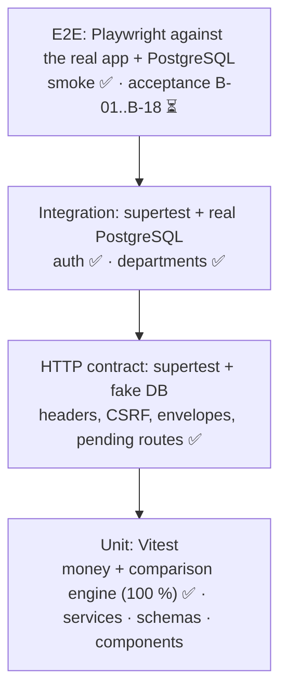

# Test Strategy

Decision record: [ADR-0010](../adr/0010-testing-strategy.md). Tests are written first (red, green, refactor). A ticket is done only when its acceptance criteria are automated.

## 1. Pyramid

| Layer         | Purpose                                                                           | Tooling                               | Runs in                                |
| ------------- | --------------------------------------------------------------------------------- | ------------------------------------- | -------------------------------------- |
| Unit          | Pure domain rules, schemas, services with injected repositories, React components | Vitest, Testing Library, jsdom        | `./run.sh test`, CI                    |
| HTTP contract | Middleware order, envelope shape, auth/CSRF/permission gates without a database   | Vitest + supertest, `fakeDb()` helper | `./run.sh test`, CI                    |
| Integration   | Real SQL, constraints, transactions, tenant isolation, audit atomicity            | Vitest + supertest + PostgreSQL 17    | `./run.sh test`, CI (Postgres service) |
| End-to-end    | User journeys through the browser against the running app                         | Playwright (Chromium)                 | `./run.sh e2e`                         |

## 2. Coverage gates

- **Overall target ≥ 80 %** lines/branches per workspace (`npm run test:coverage`, run in CI).
- **100 % statements, branches, functions and lines** on `packages/shared/src/domain/**` (money and bid comparison), enforced by `coverage.thresholds` in `packages/shared/vitest.config.ts`. A drop fails CI.
- Excluded from API coverage: `src/index.ts`, `src/db/cli.ts`, `src/db/seed.ts` (process wiring and development data).

## 3. Test data

| Data            | Source                                                  | Notes                                                                                                                                           |
| --------------- | ------------------------------------------------------- | ----------------------------------------------------------------------------------------------------------------------------------------------- |
| Development     | `./run.sh seed` (idempotent)                            | Cedar Grove Hotels (USD) and Harborview Clinics (EUR), one login per role, departments in both. Full PRD §8 dataset ⏳ BF-053                   |
| Integration     | `freshDatabase()` in `apps/api/test/db-setup.ts`        | Drops and recreates the `public` schema of `TEST_DATABASE_URL` (`bidflow_dev_test` locally, `bidflow_test` in CI), migrates and seeds per suite |
| Isolation       | `fileParallelism: false` in `apps/api/vitest.config.ts` | DB suites share one schema, so files run sequentially                                                                                           |
| Domain fixtures | `packages/shared/test/domain/fixtures.ts`               | PRD §8 case: 20 AC units; Metro Electrical cheapest but non-compliant; Allied Facilities lowest qualified                                       |
| E2E             | Development database                                    | Smoke test creates a department with a timestamped code so reruns do not collide                                                                |

Never point `TEST_DATABASE_URL` at a database you care about: the schema is dropped.

## 4. Existing test inventory

### packages/shared

| File                                       | Proves                                                                                                                                                  |
| ------------------------------------------ | ------------------------------------------------------------------------------------------------------------------------------------------------------- |
| `test/domain/rounding.test.ts`             | ROUND HALF UP for positive/negative values; safe-integer guard                                                                                          |
| `test/domain/money.test.ts`                | Money construction, add/subtract/sum/compare, currency mismatch, overflow, bigint string parsing                                                        |
| `test/domain/money-format.test.ts`         | Display and plain formatting for 0/2/3-exponent currencies; float-free parsing that refuses extra decimals                                              |
| `test/domain/quantity.test.ts`             | Milli-unit quantities; unit price × quantity with one rounding; products beyond 2^53 computed exactly                                                   |
| `test/domain/basis-points.test.ts`         | bps range checks, rate application, percentage formatting                                                                                               |
| `test/domain/evaluation-criteria.test.ts`  | B-09: weights must total 100 %, exactly one price criterion, at least one qualitative criterion                                                         |
| `test/domain/scoring.test.ts`              | FR-06 price formula, mean qualitative scores, ppm rounding, score validation                                                                            |
| `test/domain/bid-comparison.test.ts`       | PRD §8 case, lowest-priced vs lowest qualified, B-10 exclusion, withdrawn/currency/incomplete rules, deterministic tie-breaking, provisional evaluation |
| `test/domain/award-recommendation.test.ts` | B-11 justification for non-top-ranked bid; unqualified bids blocked                                                                                     |
| `test/roles.test.ts`                       | Permission matrix: supplier confinement, clerk restrictions, admin-only department management                                                           |
| `test/departments.schema.test.ts`          | Department input normalisation; rejects fractional/negative budgets and client-supplied currency or organization                                        |
| `test/schemas.test.ts`                     | Login and pagination schemas, role guard                                                                                                                |

### apps/api

| File                                               | Proves                                                                                                                                       |
| -------------------------------------------------- | -------------------------------------------------------------------------------------------------------------------------------------------- |
| `test/app.http.test.ts`                            | Health endpoints, security headers, 404 envelope, 401 on protected routes, cross-origin rejection, validation                                |
| `test/pending-routes.http.test.ts`                 | Sample of PRD §7 pending routes return 501 + ticket; wrong roles get 403 first                                                               |
| `test/error-handler.test.ts`                       | Domain errors become 422 with `domainCode`; unknown errors become generic 500                                                                |
| `test/department.service.test.ts`                  | Session-scoped queries, offset maths, defence-in-depth permission checks, conflict mapping, rollback                                         |
| `test/departments.db.test.ts`                      | FR-01 slice on PostgreSQL: list/search/paginate, create in org currency with one audit row, 409/422, B-18 tenant isolation, RBAC, role CHECK |
| `test/integration.db.test.ts`                      | Migration idempotency, login + CSRF + logout, login audit, generic wrong-password error                                                      |
| `test/auth.service.test.ts`                        | Session creation with hashed token; identical errors for each failure mode                                                                   |
| `test/password.test.ts`, `test/tokens.test.ts`     | scrypt hashing, token entropy, CSRF derivation, constant-time compare                                                                        |
| `test/env.test.ts`, `test/not-implemented.test.ts` | Environment validation; pending router contract                                                                                              |

### apps/web and e2e

| File                                     | Proves                                                                                                                   |
| ---------------------------------------- | ------------------------------------------------------------------------------------------------------------------------ |
| `apps/web/test/client.test.ts`           | Envelope unwrapping, `ApiError`, CSRF header only on unsafe methods                                                      |
| `apps/web/test/navigation.test.ts`       | Every pending screen has a BF ticket; supplier navigation confinement; department visibility by role                     |
| `apps/web/test/DepartmentTable.test.tsx` | Minor units rendered as `USD 180,000.00`; empty state                                                                    |
| `apps/web/test/PendingPage.test.tsx`     | Placeholder shows title and ticket                                                                                       |
| `e2e/tests/smoke.spec.ts`                | Anonymous redirect, invalid login, admin creates a department through the UI, pending screen ticket, supplier navigation |

## 5. PRD §9 acceptance tests

| ID   | Scenario                                       | Planned spec                                                                                        | Delivering tickets             | Status              |
| ---- | ---------------------------------------------- | --------------------------------------------------------------------------------------------------- | ------------------------------ | ------------------- |
| B-01 | Requester creates and submits purchase request | `e2e/tests/b01-b04-requests.spec.ts`, `apps/api/test/purchase-requests.db.test.ts`                  | BF-017, BF-018, BF-054         | ⏳                  |
| B-02 | Requester attempts to approve own request      | `apps/api/test/approvals.db.test.ts`, `e2e/tests/b01-b04-requests.spec.ts`                          | BF-020, BF-054                 | ⏳                  |
| B-03 | Finance approves above threshold               | `apps/api/test/approval-rules.test.ts`, `apps/api/test/approvals.db.test.ts`                        | BF-019, BF-020, BF-054         | ⏳                  |
| B-04 | Procurement publishes RFQ                      | `apps/api/test/rfqs.db.test.ts`, `e2e/tests/b01-b04-requests.spec.ts`                               | BF-029, BF-030, BF-054         | ⏳                  |
| B-05 | Uninvited supplier opens RFQ id                | `apps/api/test/supplier-portal.db.test.ts`, `e2e/tests/b05-b09-bidding.spec.ts`                     | BF-033, BF-055                 | ⏳                  |
| B-06 | Supplier A views supplier B's bid              | `apps/api/test/supplier-portal.db.test.ts`, `e2e/tests/b05-b09-bidding.spec.ts`                     | BF-033, BF-055                 | ⏳                  |
| B-07 | Supplier saves draft then submits              | `apps/api/test/bids.db.test.ts`, `e2e/tests/b05-b09-bidding.spec.ts`                                | BF-034, BF-035, BF-055         | ⏳                  |
| B-08 | Submission after deadline                      | `apps/api/test/deadline.test.ts`, `apps/api/test/bids.db.test.ts`                                   | BF-031, BF-035, BF-055         | ⏳                  |
| B-09 | Weights do not total 100 %                     | `packages/shared/test/domain/evaluation-criteria.test.ts` ✅; `apps/api/test/rfqs.db.test.ts` ⏳    | BF-008 ✅, BF-028, BF-055      | ⏳ (domain ✅)      |
| B-10 | Lowest-priced bid disqualified                 | `packages/shared/test/domain/bid-comparison.test.ts` ✅; `apps/api/test/evaluations.db.test.ts` ⏳  | BF-008 ✅, BF-038, BF-056      | ⏳ (domain ✅)      |
| B-11 | Non-top-ranked bid recommended                 | `packages/shared/test/domain/award-recommendation.test.ts` ✅; `apps/api/test/awards.db.test.ts` ⏳ | BF-008 ✅, BF-040, BF-056      | ⏳ (domain ✅)      |
| B-12 | Approver awards supplier                       | `apps/api/test/awards.db.test.ts`, `e2e/tests/b10-b18-award-po.spec.ts`                             | BF-041, BF-056                 | ⏳                  |
| B-13 | Unauthorized PO issue                          | `apps/api/test/purchase-orders.db.test.ts`                                                          | BF-043, BF-056                 | ⏳                  |
| B-14 | Partial delivery receipt                       | `apps/api/test/receipts.db.test.ts`, `e2e/tests/b10-b18-award-po.spec.ts`                           | BF-045, BF-056                 | ⏳                  |
| B-15 | Over-receive PO line                           | `apps/api/test/receipts.db.test.ts`                                                                 | BF-045, BF-056                 | ⏳                  |
| B-16 | Reload and restart server                      | `e2e/tests/b16-persistence.spec.ts` (restarts API between steps)                                    | BF-056                         | ⏳                  |
| B-17 | Duplicate POST for award/receipt               | `apps/api/test/idempotency.db.test.ts`                                                              | BF-041, BF-045, BF-047, BF-056 | ⏳                  |
| B-18 | Org B queries Org A                            | `apps/api/test/departments.db.test.ts` ✅ (departments); `apps/api/test/tenant-sweep.db.test.ts` ⏳ | BF-011 ✅, BF-057, BF-056      | ⏳ (departments ✅) |

## 6. Additional unit-test requirements (PRD §9)

| Area                 | Location                                                                                                     | Status    |
| -------------------- | ------------------------------------------------------------------------------------------------------------ | --------- |
| Weighted scoring     | `packages/shared/test/domain/scoring.test.ts`, `bid-comparison.test.ts`                                      | ✅ BF-008 |
| Monetary math        | `packages/shared/test/domain/money*.test.ts`, `quantity.test.ts`, `basis-points.test.ts`, `rounding.test.ts` | ✅ BF-007 |
| Approval thresholds  | `apps/api/test/approval-rules.test.ts`                                                                       | ⏳ BF-019 |
| Deadline comparisons | `apps/api/test/deadline.test.ts`                                                                             | ⏳ BF-031 |
| Receipt totals       | `apps/api/test/receipt-totals.test.ts`                                                                       | ⏳ BF-045 |

## 7. Running the tests

| Command                                                                                 | What it runs                                                                                                |
| --------------------------------------------------------------------------------------- | ----------------------------------------------------------------------------------------------------------- |
| `./run.sh test`                                                                         | Creates `<db>_test` if missing, then unit + HTTP + integration tests for all workspaces                     |
| `./run.sh check`                                                                        | Lint, Prettier check, typecheck, then `./run.sh test` (what CI runs, minus coverage)                        |
| `./run.sh e2e`                                                                          | Setup (migrate + seed), installs Chromium if possible, runs Playwright; reuses a running dev server locally |
| `npm run test:coverage`                                                                 | Vitest with v8 coverage per workspace; enforces the domain 100 % threshold                                  |
| `npm test -w @bidflow/shared`                                                           | Shared package only (no database needed)                                                                    |
| `TEST_DATABASE_URL=postgres://localhost:5432/bidflow_dev_test npm test -w @bidflow/api` | API suites including PostgreSQL integration                                                                 |
| `npm run test:e2e`                                                                      | Playwright only, against `http://localhost:5172`                                                            |

Without `TEST_DATABASE_URL`, the PostgreSQL suites are skipped (`describe.skipIf`), so `npm test` stays usable on machines without a database; CI always provides one.

## 8. Conventions

- One behaviour per test; names describe the rule, e.g. "isolates tenants: Harborview cannot read Cedar Grove departments".
- Every tenant-owned endpoint ships with a foreign-tenant 404 test and a wrong-role 403 test.
- Money assertions use integer minor units, never formatted strings, except in display tests.
- Fix the implementation, not the test, unless the test encodes a wrong requirement.
